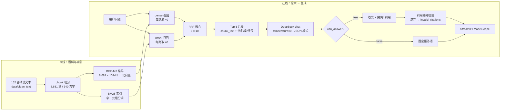
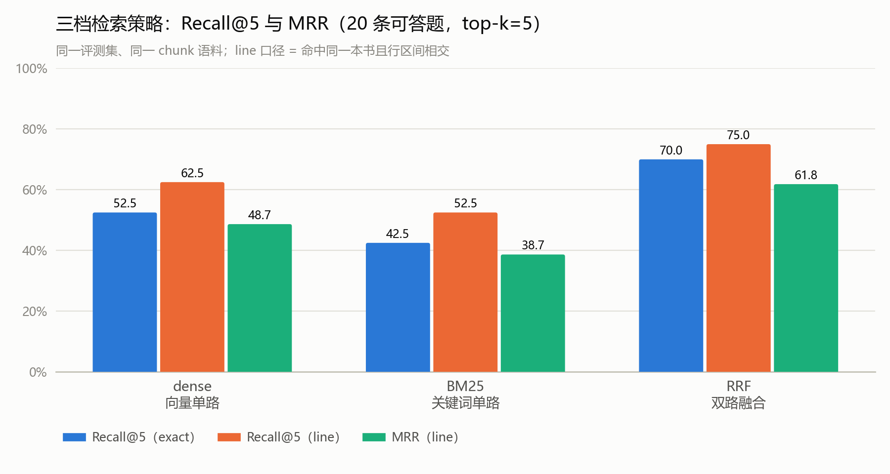

# 命理古籍 RAG Agent · v1.5

一个「只回答古籍原文里写了什么」的检索增强 Agent：**45 部命理古籍 / 8,681 个 chunk / 约 340 万字** → BGE-M3 + BM25 双路召回 → RRF 融合 → DeepSeek 生成 → **ReAct 工具调用 / 多 Agent 编排** → **强制引用 + 无依据拒答**。

[公开 Demo（ModelScope 创空间）](https://modelscope.cn/studios/Trueful/mingli-rag) ·
[直达 Streamlit](https://trueful-mingli-rag.ms.show) ·
[HTTP API 文档](#61-http-apiv14) ·
[检索评测明细](eval/results_8681_tuned.csv) ·
[拒答评测明细](eval/refusal_results.csv) ·
[Agent A/B 报告](eval/REPORT.md) ·
[排盘模块](#11-排盘模块v11) ·
[语料工程说明](docs/corpus_pipeline.md) ·
[开发日志](docs/daily_dev_journal.md)

> **免责声明**
> 本项目是大模型 RAG 与工具调用 Agent 的学习与作品集项目。语料是历史文献；**排盘是确定性的历法/天文计算**；解读属于文化娱乐内容，不是预测，也不构成医疗、法律、投资或人生决策建议。
>
> **项目边界**
> 提示词明确禁止把古代概念套到现代生活（科举 ≠ 考研、田宅 ≠ 商品房、官星 ≠ 考公），检索不到依据就拒答。这条边界本身就是评测项之一（10 条语料外问题）。

---

## 1. 为什么做这个

古籍问答最要命的失败不是答得浅，而是**编造原文**——模型用现代常识补出一句听起来很像古籍的话，用户无法分辨。

所以 v1 的核心不是"答得好"，是**"每句结论都能指回原文某一段，指不到就说不知道"**。落到代码里就三件事：

1. 只允许使用检索到的 Top-5 片段，禁止使用预训练知识；
2. 每条结论必须标 `[编号]`，编号越界或为 0 条时直接标记为不合规输出；
3. 片段只是主题相近但答不了问题，就拒答（`can_answer=false`）。

可信度需要用数字证明，所以同时做了 30 条人工评测集和一套可重跑的评测脚本。

---

## 2. 架构



| 层 | 实现 | 位置 |
|---|---|---|
| 语料 | 45 部 / 8,681 chunk（标点组 16 部 2,830 + 无标点组 29 部 5,851），目标 450 字 / 上限 700 / 句级重叠 60 | `data/chunks/punct.jsonl`、`data/chunks/unpunct.jsonl` |
| 向量化 | BGE-M3，1024 维，归一化后存 `.npy` | `src/embed.py` → `data/embeddings.npy` |
| dense 检索 | 纯 numpy 矩阵乘；8,681 条暴力全量，毫秒级，不需要向量库 | `src/retrieval.py:41` |
| 稀疏检索 | `rank_bm25` + 字二元组分词（不依赖 jieba 词典） | `src/retrieval.py:47` |
| 融合 | RRF，k=10，每路先取 40 再截 Top-5 | `src/retrieval.py:53` |
| 生成 | `deepseek-chat`，`temperature=0`，`response_format=json_object` | `src/rag.py:59` |
| 约束 | 引用编号 → chunk_id 映射与校验；声称能答但零有效引用 → `invalid_output` | `src/rag.py:116` |
| 界面 | Streamlit：面向访客的「问古籍」「排盘」两页；检索后端、Top-k、轨迹、数据/评测中台收进维护页（`?admin=1`） | `src/app.py` |
| API | FastAPI：`/chat`、`/retrieve`、`/trace`、`/health`；并发信号量 + 可选 Bearer token | `src/api.py` |
| 部署 | ModelScope 创空间，入口见 `modelscope.yml`；独立 API 走 `Dockerfile` / `docker-compose.yml` | `app.py`、`Dockerfile` |

**一次请求发生了什么**

1. 用户问题进 `retrieve_one(question, top_k, mode)`；
2. dense 与 BM25 各取 40 条候选，RRF 融合后截 Top-5（`mode` 可强制只走单路，维护页里有单选框）；
3. 5 个片段按 `[1]…[5]` 编号拼进 prompt，每个片段带《书名·卷·章》；
4. DeepSeek 返回 JSON：`can_answer / answer / citations / refusal_reason`；
5. `citations` 里的编号校验在 1..5 之间，映射回 `chunk_id`；越界编号进 `invalid_citations`，界面红色报错。

**多轮对话（v1.3）**

1. 界面用 `st.session_state` 保存本次会话的 user / assistant 消息，刷新页面才清空；标题旁的「新对话」显式清空；
2. 后端只取最近 **3 轮 / 1200 字**，先让模型把追问改写成不依赖上文的独立问题（`{"standalone": "..."}`）；
3. 改写后的问题才进入检索；Agent 模式把同一句独立问题交给 Planner / Retriever / Verifier / Synthesizer；
4. **历史只用于消解指代，不作为回答证据**；引用白名单仍然只认本轮工具实际返回的 `chunk_id`；
5. 改写失败（网络、额度、非法 JSON）一律退回原问题——多轮是增强，不能把单轮能力拖垮。

实现集中在 `src/conversation.py`；三种后端都接受 `history=` 参数，并在返回值里带 `rewritten_question / history_turns / llm_calls`。测试见 `tests/test_conversation.py`。

**界面（v1.5）**

访客只看得到两页：

- **问古籍**：首屏是四个可以直接点的问题；回答下方把引用整理成「原文出处」编号，点开能看具体段落；每轮给两三个可点的追问；没有依据时不是硬答，而是说明「这句古籍里没有直接依据」。多轮对话的上下文只用来消解指代，界面不展示改写后的检索问句。
- **排盘**：八字、星盘、塔罗三个工具，排盘本身不调用模型，只有「解读」这一步才消耗额度。

工程细节收进维护页：URL 加 `?admin=1` 或设 `MINGLI_ADMIN=1` 才会出现「维护」入口，里面是检索后端（单轮 RAG / 单 Agent / 多 Agent）、Top-k 滑杆、逐轮轨迹，以及数据中台和评测中台两个页签。公开部署不开这个变量，访客就看不到 RRF、BM25、多 Agent 这些词。

Key 与额度：服务端配了 `DEEPSEEK_API_KEY` 就走服务端 Key，否则访客可以填自己的 Key——只存在当前会话，不写日志、不落盘。免费额度默认每会话 6 次、全站每天 300 次（`MINGLI_SESSION_LLM_LIMIT` / `MINGLI_DAILY_LLM_LIMIT` 可调），计数文件 `data/.quota.json` 不进仓库。

**数据中台 / 评测中台（v1.3，MVP）**

| 能力 | 现在做到什么 | 位置 |
|---|---|---|
| 数据版本 | 语料内容指纹 → `ds-xxxxxxxxxxxx`，同版本重复扫描不新增 | `src/datahub.py` |
| 版本血缘 | chunk 文件、`embeddings.npy`、术语表的 sha256 / 大小 | `datahub.assets_for()` |
| 质量门 | 12 项：空 chunk、重复 id、重复正文、缺 sourcefile/行号、embedding 行数/维度/NaN | `datahub.scan()` |
| 评测账本 | `eval_runs` + `eval_cases`：suite、backend、数据集版本、配置、逐题明细 | `src/evalhub.py` |
| 回归门 | 检索 R@5 掉 >2 个点、Agent 通过率掉 >5 个点、拒答正确率掉 >2 个点 → 失败 | `evalhub.compare()` |
| 界面 | 「评测中台」「数据中台」两个页签；可导入历史结果、跑检索评测、看逐题、比版本 | `src/app.py` |

范围要说清楚：中台本身仍是**单机 MVP**——一个 SQLite 文件、Streamlit 管理页、没有多租户和权限（对外服务另见 [§6.1 HTTP API](#61-http-apiv14)）。选择这个范围是因为它已经能回答「这份数据和上次评测是不是同一版」「这次改动有没有把指标跑崩」两个真实问题，而不是先摆一套中间件。

---

## 3. 结果

评测集 30 条：**20 条可答**（单跳释义 8 / 口语改写 4 / 应用推理 4 / 跨书对比 3 / 多跳综合 1）+ **10 条语料外**（考研、考公、买房、整容、彩票等）。全部 Top-k=5。

### 3.1 检索

| 策略 | Recall@5（exact） | Recall@5（line） | MRR（exact） | MRR（line） |
|---|---:|---:|---:|---:|
| dense（BGE-M3） | 52.5% | 62.5% | 41.2% | 48.7% |
| BM25（字二元组） | 42.5% | 52.5% | 36.0% | 38.7% |
| **RRF 融合** | **70.0%** | **75.0%** | 50.8% | 61.8% |

语料从 2,830 条扩到 8,681 条后，RRF 的 line Recall@5 一度从 77.5% 掉到 70.0%：
两路各自都没退步（dense 不变、BM25 从 47.5% 涨到 52.5%），退化只发生在融合环节。
原因是 `rrf_k=60` / `candidate_k=20` 在 2,830 条时调的——k=60 时第 1 名和第 20 名的
权重是 1/61 : 1/80 ≈ 1.3 倍，候选池一大就基本没有区分度。用 `eval/tune_rrf.py`
在 8,681 条上重扫（280 组配置），改成 `rrf_k=10` / `candidate_k=40` 后回到 75.0%，
且逐题对比**只多命中 1 题、没有任何回退**。三次评测的完整明细见 `eval/baselines.md`。

> 20 道题里 1 道题就是 5 个百分点，这个提升在统计上还不算显著。
> 参数是在同一批题上搜出来又报告的，存在过拟合风险；扩充评测集后需要复验。



- **exact**：返回的 `chunk_id` 必须等于标注的 gold 块；
- **line**：同一本书且行区间相交就算命中，用来吸收 chunk 边界差异（口径更松，两个数一起报）。

分题型 Recall@5（RRF，line 口径）：

| 题型 | n | dense | BM25 | RRF |
|---|---:|---:|---:|---:|
| 单跳释义 | 8 | 88% | 38% | 75% |
| 口语改写 | 4 | 25% | 50% | 50% |
| 应用推理 | 4 | 50% | 75% | **100%** |
| 跨书对比 | 3 | 67% | 83% | 83% |
| 多跳综合 | 1 | 50% | 0% | 50% |

**这张表解释了为什么下一步要做 agent。** 单跳释义题上 dense 碾压 BM25（88% vs 38%），
应用推理题上反过来（50% vs 75%）——一个全局融合权重注定只能取平均。
要让两类题都不掉分，只能让模型按题目类型自己选检索方式，而不是写死一个权重。

### 3.2 生成与拒答

| 指标 | 结果 | 说明 |
|---|---|---|
| 语料外拒答率 | **10/10** | 全部拒答，没有一条被"算"成命理问题 |
| 可答题误拒 | 1/20 | q01（见 4.1） |
| 回答中至少一条引用命中 gold | 15/19 | 78.9%；剩下 4 条答了但没有引到标注块 |
| 首条引用即命中 gold | 11/19 | 57.9%——引用能对上，但排序不对 |
| 不合规输出（`invalid_output`：声称能答却零有效引用） | 0/30 | 引用编号全部落在 1..5 内 |

### 3.3 Agent 评测：单 Agent vs 多 Agent

固定单轮检索的瓶颈在 §3.1 已经说明：一个全局 RRF 权重只能对题型取平均。v1.2 把检索改成 ReAct 工具调用，再进一步拆成 Supervisor / Retriever / Verifier 三个角色；两版用同一批 15 条任务、同一工具预算（6 步）、同一套引用白名单，各跑 3 次：

| | 单 Agent | 多 Agent |
|---|---:|---:|
| 三次通过数 | 9、8、7 | 13、13、12 |
| 均值（区间） | **8.0 / 15（7–9）** | **12.7 / 15（12–13）** |
| 双书显式检索 | 2.5 / 10 | **9.0 / 10** |
| 拒答正确 | 8 / 9 | **9 / 9** |
| 复合题通过 | 0 / 6 | **5 / 6** |
| LLM 调用 / 题 | ≈3.8 | 8.3 |
| **每通过一题消耗的 LLM 调用** | **≈7.1** | **≈9.8（+38%）** |
| 单次跑完 15 题 | 150s | 204s |

两个区间不重叠（单 Agent 最高 9 < 多 Agent 最低 12），但样本只有 15 条，**不作显著性推断**。

多 Agent 的收益来自三个具体修复，而不是「多一个角色」本身：规划时枚举必须查的书、检索员的书名由代码强制覆写、Verifier 逐本核对并回补缺口。第一版多 Agent 只有 1/15，修完才到 13/15；`a02` 和 `b04` 是两条已知失效，判据本身有缺陷，报告里没有为了好看改判据。

公网 Demo 的「古籍问答」页可以在「单轮 RAG / 单 Agent / 多 Agent」之间切换；Agent 模式会展开每一步的工具、参数、chunk_id 与总耗时，引用仍走同一套白名单校验。

完整逐题配对、成本拆解与失效分析见 [`eval/REPORT.md`](eval/REPORT.md)。


### 3.4 上下文工程：项目里具体做了什么

「上下文工程」在这个项目里不是一句口号，而是几处可以指到代码的约束：

| 环节 | 做法 | 位置 |
|---|---|---|
| 检索上下文 | 每路取 40 条候选，RRF 融合后只把 Top-5 拼进 prompt；每段带 `[序号]《书名·卷·篇》`，空字段不拼 | `src/rag.py:49` |
| 工具观察 | 工具结果统一压成一条 `observation`；失败的调用也回给模型，避免它重复同一个错误 | `src/agent.py:54` |
| 步骤预算 | 单/多 Agent 共用 6 步预算；走满还没收口就强制按「证据不足」拒答 | `src/agent.py:22`、`src/agent_multi.py` |
| 证据去重 | 多 Agent 用 `chunk_id` 做 key 合并证据，同一段原文只进上下文一次 | `src/agent_multi.py:94` |
| 缺口回补 | Verifier 最多指出 2 条缺口，Supervisor 用 `fetch_chunk` 或限定书名重查，而不是把整库再塞一遍 | `src/agent_multi.py:326` |
| 引用白名单 | 只有工具实际返回过的 `chunk_id` 才能进 `citations`；无效引用会被标出并判为不合规 | `src/agent.py` 的 `_finalize` |
| 多轮历史 | 只取最近 3 轮 / 1200 字，从旧到新丢；追问先改写成独立问题，历史只用于消解指代 | `src/conversation.py` |
| 多轮引用隔离 | 每轮引用只来自本轮工具返回的 chunk；历史里出现过的旧结论不能当引用 | `src/rag.py`、`src/agent.py` |
| 多轮失败回退 | 改写超时 / 额度 / 非法 JSON 时退回原问题，单轮链路不受影响 | `src/conversation.py` 的 `rewrite_question` |

还没做的：长期记忆与会话摘要、按 token 精确截断（目前按字符）、多轮专项评测集、reranker、RAGAS 忠实度。

### 3.5 评测的可归因性：state 版本、冻结题集、单轮单变量

§3.3 的数字回答「多 Agent 比单 Agent 高多少」，但回答不了另一个问题：
**这个数字是哪一版提示词跑出来的，两次 run 之间到底改了什么。**

v1.6 把评测从「有分数」推进到「可归因」，一共四件事。

**① 提示词与参数是一个带哈希的整体。** `src/prompts/*.md` 与 `src/agent_config.json`
组成 Agent State，`src/agent_state.py` 对它们算一个 `state_version`。每次 run 把它写进
`eval_runs`，同时存每个文件的哈希。于是：

```text
state a1b2c3d4e5f6 → 7a8b9c0d1e2f
  只改了 prompts/verifier.md
```

改动是哪次分数变化的来源，从「回忆」变成「查表」。历史 run 没有这个字段（NULL），
只用于对照，不参与改动前后的强结论。

**② 题面与判据分开，Benchmark 冻结。** 以前 `agent_tasks.jsonl` 把题目和
`required_tools` / `pass_criteria` 写在同一行，调提示词时很容易顺手看到判据。
现在：

```text
eval/tasks/agent_v1/
├── benchmark.json     # 版本、冻结时间、cases 的 sha256、dev/holdout 划分
├── cases.jsonl        # 公开：id / split / type / name / question / max_steps
└── gold/<id>.json     # 私有：required_tools / evidence_books / pass_criteria
```

`cases.jsonl` 的 sha256 写进 `benchmark.json`；改了题却没有重新冻结，`run_agent.py`
会直接提示「结果不可与旧 run 直接比」。15 条按 10 dev / 5 holdout 划分。

> 需要说清楚的边界：这 15 条在冻结前都参与过提示词迭代，所以 v1 的 holdout
> **不是无污染的泛化指标**，它只能约束**之后**的改动。扩到 30 条时重新冻结，
> 才会有一份真正没见过的 holdout。

**③ 先写预测，再跑。** 每轮优化的记录放在 `eval/rounds/`，跑之前写
`.prediction.json`（假设 + 预测翻绿的 case），`run_agent.py --predict` 跑完打印三行：

- 预测翻绿且确实翻绿；
- **预测翻绿但没翻**——下一轮假设的入口；
- 预测失败但过了——收益来自别处，别急着归因。

这比事后写"因为改了 X 所以涨了"更难自欺，也和 §4.6 的教训一致：判据要有方向，也要有幅度。

**④ 接受规则不用「比上次高」。** 15 题里 1 题就是 6.7 个点，单次高 1 题可能只是波动。
`evalhub.accept_candidate()` 只在两种情况下接受：

| 证据 | 判定 |
|---|---|
| 候选最差的一次 > 基准最好的一次（3 次 run 区间不重叠） | accept（强） |
| 均值涨幅换算成题数 ≥ 1 题，且无指标跌破回归门 | accept（弱） |
| 候选最差低于基准均值超过阈值 | reject |
| 其余 | inconclusive——不当作改进，也不当作退步 |

同时，`case_matrix()` 把同一实验的多次 run 对齐成 case × run 矩阵，
「翻转率」和「稳定通过率」和总分一起看——§3.3 里「多 Agent 的收益是可复现性」
这句话，现在是一个可以算出来的数，而不是手工数出来的结论。

用法：

```bash
# 跑 dev，先写预测
python eval/run_agent.py --agent multi --tag multi_r4 --split dev \
  --predict eval/rounds/some-round.prediction.json

# 判接受：引用 3 次基准 run 和 3 次候选 run
python eval/compare_runs.py --accept 18 19 20 --candidate 21 22 23

# 看翻转
python eval/compare_runs.py --matrix 18 19 20
```

每题还会记录 `trace_id`、`llm_calls` 与 token 数，分数可以直接跳回
`eval/results_agent_<tag>.json` 里对应的那条 trace，也能算「每通过一题花了多少次调用」。

---

## 4. 失败案例

这一节按"实际发生了什么"写，不按指标好不好看做筛选。

### 4.1 RRF 把单路强命中挤出了 Top-5（q01）

「算命的说我命里带羊刃…白天生和晚上生犯的不一样吗？」

dense 把 gold（`chunk 83`，张果星宗）排在**第 2 名**；BM25 没有召回它；融合后 gold 掉出 Top-5，系统于是**误拒**。

原因是 RRF 只吃排名、不看分数：每路只取 20 条候选，gold 不在 BM25 前 20，融合分只有 `1/(2+60) ≈ 0.016`；而一个两路都排第 20 的弱相关块能拿到 `2/80 = 0.025`。**"两路都出现"压过了"单路很强"**。

这是"混合检索一定比单路好"的直接反例，也是 v1.1 第一个要改的地方（加深候选池 / 加权融合 / 对单路 top-3 做保底）。

### 4.2 拿到了等价的另一块，但 gold 只标了一块（q03）

「禄、命、身三样分别怎么定？」

gold 是 `五行精纪` 第 621 块（"谈命者当分禄命身，以干配禄，以支合命，以纳音论身"）。模型召回并引用了第 676 块（"干为禄，定贵贱；支为命，定修短；纳音为身，察盛衰"）——**内容同样成立，引用也正确**，但按 chunk_id 严格比对记 0 分。

同类情况：q13「丁未碰癸丑、丁丑、己丑算不算破」——原文其实就在第 **927** 块，gold 标注却是相邻的第 926 块（两块的行区间共享第 3383 行）。模型引用 927 是对的，exact 判 0、line 判 1。**这里错的是标注，不是模型。**

结论：**exact 口径会低估**，单 gold 标注也会低估。这两个 0 不是检索失败，是人写的评测口径太窄。对外宣传用 line 口径时，必须同时说明这一点。

### 4.3 真正的检索失败：口语改写（q09、q11）

「甲木是栋梁、乙木是花草，乙木命不如甲木？」「乙木的长生位跟甲木相反？」

三档检索、两种口径**全部为 0**。古籍原文没有"栋梁/花草"这种说法，BM25 字面零交集；BGE-M3 也没把口语转述映射到《滴天髓阐微》的"五阳皆阳丙为最"。

口语改写类 line Recall 只有 50%，是所有题型里最弱的。这不是模型大小的问题，是**查询侧没有做改写/术语映射**。

### 4.4 BM25 赢、向量输的例子（q10、q15、q16）

- q10「两个地支相冲，怎么知道谁强谁弱」：BM25 exact=1.0，dense exact=0；
- q15「乙木日主，伤官旺、庚金成病，走壬申癸酉还是丙子丁丑」：BM25 exact=1.0，dense exact=0；
- q16「丙午年庚寅月初九午时，几岁起运」：BM25 exact=1.0，dense exact=0。

干支组合、术语原词这类**字面强信号**问题，BM25 明显更好。混合检索的理由不是"两个都比一个强"，而是**两类错误不重叠**。

### 4.5 多 gold 只中一半（q20）

「甲木生在正月，没火、水偏多，是不是不好？」

gold 两段（`2750` 总论、`2751` 正月甲木），只召回 2751，Recall@5 = 0.5。多跳题需要两段拼起来才能答，v1 的 Top-5 是"取排名前 5"，没有任何多样性约束，容易全落在同一段。

---

### 4.6 自动评测差点自己骗自己：相似度涨 0.002 也算"修好"

线上反馈闭环的第一条用例，问「有几种贵格」。原回答把《五行精纪·论贵局上》的 51 个条目整段抄了一遍，但没有回答"几种"，也没给出处和分档。据此提交差评，`expected_answer` 写成"原书没有直接给出总数……约五十一种，分卿相王侯与凤阁鸾台两档"。

第一次重跑，**通过率 1.0**。看起来是修好了。查逐题明细才发现：

```text
old_similarity = 0.0195
new_similarity = 0.0215     # 只涨了 0.002
```

模型只是多抄了一句"又贵格"，仍然没有回答数量。判据写的是 `new_sim > old_sim`，于是把 LLM 的随机波动当成了修复。**没有阈值的自动评测会骗自己。**

修复（`src/evalhub.py`）：要求新答案的相似度比旧答案至少高 `MIN_SIM_GAIN = 0.02`，低于阈值判为噪声并写明原因。重跑后：

```text
pass_rate = 0.0
回归门对基线 1.0 判定 fail，退出码 1
```

这次失败才是真相：系统确实还没解决这条差评。用新的 0.0 作基线继续迭代，通过率上升才有意义。

> 教训：差评用例的判据不能只有方向（更接近），还要有幅度（接近多少）。方向对了但幅度在噪声里，等于没改进。

---

## 5. 局限（诚实清单）

| # | 局限 | 影响 | 下一步 |
|---|---|---|---|
| 1 | 索引已覆盖 45 部 / 8,681 块（标点组 16 部 + 无标点组 29 部），但**评测集仍只按前 16 部出题** | 75.0% 只代表"问的书在库里"时的检索质量，29 部无标点组还没有对应题目，真实覆盖率未被测量 | 为无标点组补 30–40 道题，再重跑一次 |
| 2 | 评测集 30 条、单人标注，可答 20 条 | 1 条题 = 5 个百分点；跨书对比只有 3 条、多跳 1 条，题型间差异不可靠 | 扩到 80 条 + 双人标注 |
| 3 | exact / line 两个口径差 5–10 个点；line 口径偏松（共享一行即命中） | 只报一个数会误导；q03/q13 说明 exact 也会误伤 | 两个数一起报；补"引用段落包含答案要点"的人工核验 |
| 4 | chunk 目标 450 字、句级重叠 60 字 | 定义跨块时仍会切断答案；相邻块内容重复，`exact` 判分不稳 | v2 调重叠与边界规则 |
| 5 | BM25 用字二元组，**没有接 jieba 和 324 条术语词典**（词典已备好未接入） | 古汉语单字词多，二元组引入噪声；口语 query 字面零交集 | 接入 jieba + 术语词典 |
| 6 | RRF 参数已在 8,681 条上重扫（k=10 / 候选 40），但**没有 reranker** | q01 说明融合仍会伤害单路强命中；reranker 未做前后对比 | 上 bge-reranker-v2-m3，补一组同题对比 |
| 7 | 生成侧只校验**引用编号是否合法**，不校验"这段原文是否支持这句话" | 4/19 题回答没有任何 gold 引用；没有忠实度指标 | 加 RAGAS faithfulness / 人工抽检 |
| 8 | 多轮只做最近 3 轮 / 1200 字的追问改写，没有长期记忆、会话摘要和多轮专项评测集；改写本身也消耗一次 LLM 调用 | 长会话会丢早期约束；多轮质量目前只有单元测试，没有像检索那样的量化分数 | 补 20 条多轮评测（指代、省略、跨轮约束）并统计改写准确率 |
| 9 | API 的 `/chat` 已汇总 token（`usage` 字段）并在 `/metrics` 暴露总量，但还没有按题/按用户的成本报表 | 能回答"一共烧了多少 token"，还不能回答"这条用例花了多少钱" | 按 run 累计金额，接成本看板 |
| 10 | 工程细节：数据路径曾硬编码 `/workspace`（已改为仓库相对路径 + `MINGLI_DATA_DIR`）；Demo 无登录态，只有全站每日额度闸门 | 单会话限制挡不住脚本，全站额度是唯一硬闸门 | 加 Nginx 限流 + 接 Langfuse 做持久化 trace |
| 11 | 内容边界：古籍里的概念与现代生活不是一一对应 | 可能出现不恰当类比 | 提示词硬约束 + 拒绝样例回归测试 |
| 12 | 多 Agent 只在 15 条任务上测，且未统计 token/金额 | 12.7 vs 8.0 的区间不重叠，但样本小；8.3 次调用/题的成本优势未量化 | 扩到 30 条 + 逐轮 token/耗时/成本 |

> 关于"没做完"的部分：reranker、RAGAS 忠实度、微调、换 LangChain/LlamaIndex 重写，v1.3 仍然**不做**；多轮和 query rewrite 已经做了最小闭环，但只做到"能用 + 有测试"，没有包装成"多轮能力很强"。判断标准是"能不能让简历多一个数字或一个链接"，不能就推迟。

---

## 6. 快速开始

```bash
git clone https://github.com/true-12138/mingli-rag.git
cd mingli-rag

python -m venv .venv
source .venv/bin/activate          # Windows: .venv\Scripts\activate
pip install -r requirements.txt
alembic upgrade head               # 首次运行：创建业务库 7 张表，可重复执行

export DEEPSEEK_API_KEY=sk-xxxx    # PowerShell: $env:DEEPSEEK_API_KEY="sk-xxxx"
streamlit run app.py
```

- `data/embeddings.npy`（**8,681 × 1024，约 34 MB**）**已随仓库提供**，开箱即用，覆盖标点组 + 无标点组全部语料。若文件行数少于 chunk 数，启动时会打印 `[warn] 索引只覆盖前 N 条语料`，此时只检索已编码的部分。
- 重建索引：先 `python src/build_index.py` 校验语料，再 `python src/embed.py` 重新编码（8,681 条，GPU 上十几分钟，纯 CPU 要数小时）
- BGE-M3 权重首次加载需要下载（几 GB）。大陆网络可先设 `HF_ENDPOINT=https://hf-mirror.com`，或用 ModelScope 下载后指向本地目录
- 全部测试（**不调用 LLM**，包含排盘、引用白名单、多轮改写、平台表结构）：`python -m pytest tests/ -q`
- 重跑检索评测（**不调用 LLM**，只测检索）：`cd eval && python eval_matrics.py`
- 重画结果图：`python eval/make_chart.py`
- 数据中台：`python src/datahub.py` 扫描语料 / embedding，登记版本、哈希和 12 项质量门（写 `data/platform.sqlite3`）
- 评测中台：`python src/evalhub.py` 导入 `eval/` 下已有结果；界面的「评测中台」页签可以跑新的检索评测、看逐题明细、做回归门对比
- 中台数据默认落在 `data/platform.sqlite3`（已 gitignore，可由 scan / import 重建）；部署到持久化目录时设 `MINGLI_PLATFORM_DB=/path/to/platform.sqlite3`
- 语料路径默认 `<repo>/data`，可用环境变量覆盖：`MINGLI_DATA_DIR=/path/to/data`

### 6.1 HTTP API（v1.4）

Streamlit 适合演示，不适合被别的服务调用。`src/api.py` 把 RAG / 单 Agent / 多 Agent 包成同一套 HTTP 接口：

```bash
export DEEPSEEK_API_KEY=sk-xxxx
python src/api.py                 # http://127.0.0.1:8000/docs
# 或
uvicorn api:app --app-dir src --host 0.0.0.0 --port 8000
```

| 方法 | 路径 | 说明 |
|---|---|---|
| `GET` | `/health` | 语料条数、embedding 形状、模型是否已加载、并发上限 |
| `POST` | `/retrieve` | 只检索，`mode` 可选 `dense` / `bm25` / `rrf` |
| `POST` | `/chat` | 问答，`mode` 可选 `rag` / `agent` / `multi`，支持 `history` |
| `GET` | `/trace/{trace_id}` | 取回最近一次请求的完整结果（内存里保留最近 200 条） |
| `GET` | `/metrics` | Prometheus 文本格式：请求数、耗时直方图、在途数、LLM token |
| `POST` | `/v1/conversations` | 新建会话，返回 `conversation_id` |
| `GET` | `/v1/conversations` | 会话列表（含消息数） |
| `GET` | `/v1/conversations/{id}` | 会话详情与全部消息 |
| `DELETE` | `/v1/conversations/{id}` | 删除会话（级联删消息、运行、反馈） |
| `POST` | `/v1/conversations/{id}/chat` | 带服务端记忆的问答，返回 `run_id` |
| `GET` | `/v1/conversations/{id}/runs` | 该会话的运行记录 |
| `GET` | `/v1/runs/{run_id}` | 回放：答案、耗时、token、工具调用、反馈 |
| `POST` | `/v1/runs/{run_id}/feedback` | 好评/差评，差评可带 `expected_answer` |

```bash
curl -s localhost:8000/chat \
  -H 'Content-Type: application/json' \
  -d '{"question":"羊刃分几种？","mode":"rag","top_k":5}'

curl -s localhost:8000/chat \
  -H 'Content-Type: application/json' \
  -d '{"question":"那它和飞刃有什么区别？","mode":"agent","history":[
        {"role":"user","content":"羊刃分几种？"},
        {"role":"assistant","content":"羊刃有……"}]}'
```

- **鉴权**：设置 `MINGLI_API_TOKEN` 后，所有接口要求 `Authorization: Bearer <token>`；不设置则开放。
- **访客自带 key**：请求头 `X-DeepSeek-Key`，只作用于本次请求，不落日志、不进 trace。不要放在浏览器前端。
- **并发**：默认同时最多 4 个生成请求（`MINGLI_MAX_CONCURRENCY`），超了立刻 429，不排队。
- **trace**：内存缓存，进程重启即清空；持久化 trace 留给 Langfuse（下一步）。
- **token 用量**：`/chat` 响应里的 `usage` 汇总本次请求内所有 LLM 调用的 token（含追问改写、Agent 每一步、JSON 重试），字段为 `prompt_tokens / completion_tokens / total_tokens / cached_tokens / llm_calls`；采集是线程内旁路累加（`src/usage.py`），不改变 `_chat` 的签名，脚本直接调 `rag.answer` 时自动静默。日志行同时输出 `tokens=`，可直接接成本看板。
- **request id**：每个请求分配 `X-Request-Id`（客户端传了就沿用），响应头带回，JSON 日志里也带；未捕获异常返回体里有 `request_id`，用户报障时能直接对上日志。
- **结构化日志**：`MINGLI_LOG_JSON=1`（默认）输出一行一个 JSON；设 `0` 回到人类可读格式。
- **指标**：`/metrics` 输出 `mingli_http_requests_total`、耗时直方图、在途请求数、`mingli_llm_calls_total` 和 `mingli_llm_tokens_total`。path 标签用路由模板（`/trace/{trace_id}`），不会随 id 无限增长。

Docker：

```bash
docker compose up --build       # http://localhost:8000/docs
```

镜像不会打包 BGE-M3 权重，首次查询下载到 compose 的 `hf_cache` volume；语料和 34 MB embedding 随镜像提供。ECS + Nginx + systemd 的完整步骤见 [`deploy/README.md`](deploy/README.md)。

**密钥**：只从环境变量 / `.env` 读取，`.env` 已在 `.gitignore` 里，仓库不含任何 key。

**公网 Demo 的问答与解读**：若部署环境没有配置 `DEEPSEEK_API_KEY`，页面会在「古籍问答」和排盘页提供「填入自己的 DeepSeek Key」入口——key 只存在当前会话，不写日志、不落盘，也不会作用于其他访客。要在公网让所有访客免填直接可用，请在创空间的环境变量里配置该 key。

**额度闸门**（只在用服务端 key 时生效，访客自带 key 不计数）：

| 层 | 默认 | 环境变量 |
|---|---|---|
| 单会话 | 6 次 | `MINGLI_SESSION_LLM_LIMIT` |
| 全站每日 | 300 次 | `MINGLI_DAILY_LLM_LIMIT` |

计数落在 `data/.quota.json`（已 gitignore），只保留最近 7 天；进程重启不清零。单会话挡不住脚本（换个会话就重置），**全站每日上限才是硬闸门**：刷满 300 次后当天所有人只能自带 key。DeepSeek 是预付费，余额为 0 自动停，不会欠费。

### 6.2 会话记忆、运行回放与反馈闭环

`/v1` 把"一次问答"落成可回放、可评价、可回归的实体：

1. `POST /v1/conversations` 建会话，拿到 `conversation_id`；
2. `POST /v1/conversations/{id}/chat` 问答。服务端从库里读最近 3 轮历史（客户端只传 id），调用模型前先落一条 `running` 运行记录，返回 `run_id`；
3. `GET /v1/runs/{run_id}` 回放：答案、耗时、token、工具调用、已有反馈；
4. `POST /v1/runs/{run_id}/feedback` 打分（`rating` 只接受 `1` / `-1`），差评可带 `expected_answer`。

差评会变成回归用例：

```bash
python eval/promote_feedback.py            # 差评 -> eval/feedback_cases.jsonl
python eval/run_feedback.py --mode rag     # 重跑并登记基线，记下 run id
python eval/run_feedback.py --mode rag --baseline <id>   # 回归门，掉超过 5 个点退出码 1
```

自动判据在 `src/evalhub.py::judge_feedback_case`：

- 上次是拒答 → 这次必须答出来且带有效引用；
- 有 `expected_answer` → 新答案的字符二元组相似度必须比旧答案**至少高 2 个百分点**（`MINGLI_FEEDBACK_MIN_GAIN`，默认 `0.02`），且引用合规；只涨千分之几视为噪声；
- 两者都没有 → `passed=None`，转人工复核，不计入通过率。

不想配 key 也能看完整链路（假模型 + 临时数据库，不联网）：

```bash
python scripts/demo_closed_loop.py
```

---

## 7. 目录结构

```text
.
├── app.py                     # Streamlit 入口（ModelScope 按 modelscope.yml 拉起）
├── Dockerfile                 # FastAPI 单镜像（不打包 BGE-M3 权重）
├── docker-compose.yml         # 本地一键起 API + HF 权重缓存 volume
├── deploy/                    # ECS：Nginx 限流反代 + systemd 开机自启
├── src/
│   ├── app.py                 # 界面：问古籍 + 排盘；维护页（?admin=1）放中台与后端开关
│   ├── api.py                 # FastAPI：/chat /retrieve /trace /health /metrics
│   ├── api_conversations.py   # /v1：会话记忆、运行回放、差评
│   ├── guards.py              # Bearer 鉴权 + 并发信号量
│   ├── observability.py       # request-id、JSON 日志、Prometheus 指标
│   ├── db/                    # 业务库：base(连接) / models(7 张表) / repo(读写)
│   ├── app_theme.css          # 界面主题（纸色/墨色/朱砂；版式、对话、排盘卡片）
│   ├── corpus.py              # 语料唯一入口：文件顺序、chunk_id 编号、字段契约
│   ├── agent_state.py         # Agent State：提示词 + 参数的版本哈希与 diff
│   ├── prompts/               # 提示词（*.md）：single / rag / rewriter / planner / retriever / verifier / synthesizer
│   ├── agent_config.json      # max_steps、证据截断长度等；改它也会改变 state_version
│   ├── retrieval.py           # dense + BM25 + RRF（纯 numpy）
│   ├── rag.py                 # DeepSeek 调用、JSON 强制、引用校验、拒答
│   ├── conversation.py        # 多轮：历史裁剪、追问改写、失败回退
│   ├── platform_db.py         # 数据/评测中台共用的 SQLite schema 与连接
│   ├── datahub.py             # 数据版本指纹、资产哈希、12 项质量门
│   ├── evalhub.py             # run 账本、逐题明细、历史结果导入、回归门
│   ├── build_index.py         # 建索引前校验（编号连续、gold 有效、无重复）
│   ├── embed.py               # BGE-M3 离线编码 → data/embeddings.npy
│   ├── chunk_*.py             # 语料切分（细节见 docs/corpus_pipeline.md）
│   ├── validate_chunks.py     # chunk 数据契约校验
│   ├── tools.py               # Agent 工具层（检索 + 排盘，纯函数）
│   ├── agent.py               # 单 Agent：ReAct 工具调用 + 引用校验
│   ├── agent_multi.py         # 多 Agent：Supervisor / Retriever / Verifier
│   └── fortune/               # 排盘：纯计算，不经过大模型
│       ├── bazi.py            #   八字（干支/藏干/十神/五行/大运）
│       ├── astro.py           #   星盘（地心视黄经 + 整宫制）
│       ├── tarot.py           #   塔罗（78 张，seed 可复现）
│       └── interpret.py       #   解读（只解释盘面，不许改盘）
├── tests/
│   ├── test_fortune.py        # 排盘测试：结构、边界、可复现性
│   ├── test_agent_guardrails.py # 引用白名单 / 拒答 / 预算（mock LLM）
│   ├── test_conversation.py   # 历史裁剪 / 改写回退 / 引用隔离
│   ├── test_platform.py       # 数据版本 + 质量门 + 评测导入 + 回归门
│   └── test_api.py            # FastAPI 路由 / 参数校验 / trace / 错误映射
├── eval/
│   ├── questions.jsonl        # 30 题检索评测集（20 可答 + 10 语料外）
│   ├── agent_tasks.jsonl      # 15 题 Agent 评测集（legacy；冻结后由 tasks/ 取代）
│   ├── tasks/agent_v1/        # 冻结 Benchmark：cases.jsonl（公开）+ gold/（私有）+ benchmark.json
│   ├── benchmark.py           # 读冻结题集、校验 sha256
│   ├── build_benchmark.py     # 由 agent_tasks.jsonl 生成 dev/holdout 并冻结
│   ├── rounds/                # 每轮优化的记录：假设、预测、改动、run id、结论
│   ├── eval_matrics.py        # 三档检索 × exact/line 两种口径
│   ├── eval_refusal.py        # 拒答评测
│   ├── run_agent.py           # 单/多 Agent 批量跑批 + auto_judge
│   ├── REPORT.md              # 单 Agent vs 多 Agent 实验报告
│   ├── results_8681_tuned.csv # 8,681 条、k=10/cand=40 的检索明细
│   ├── refusal_results.csv    # 拒答明细（含模型原始回答）
│   ├── promote_feedback.py    # 差评 -> eval/feedback_cases.jsonl
│   ├── run_feedback.py        # 重跑差评用例 + 回归门
│   └── make_chart.py          # 由评测明细生成对比图
├── scripts/
│   └── demo_closed_loop.py    # 一条命令跑通反馈闭环（假模型、临时库）
├── data/
│   ├── chunks/punct.jsonl     # 标点组（2,830 行，chunk_id 1..2830）
│   ├── chunks/unpunct.jsonl   # 无标点组（5,851 行，chunk_id 2831..8681）
│   ├── chunks/index_report.json # build_index.py 产出的校验报告
│   └── embeddings.npy         # 8,681 × 1024
├── docs/
│   ├── corpus_pipeline.md     # 语料工程说明（原 README）
│   ├── daily_dev_journal.md   # 开发日志与踩坑
│   └── eval_questions_seed.md
├── ATTRIBUTION.md             # 语料来源与许可证
└── PLAN.md                    # 冲刺计划与范围冻结
```

---

## 8. 评测口径

写在代码里，可重跑（`eval/eval_matrics.py`）：

- **Recall@5**：gold 块中被 Top-5 覆盖的比例；多 gold 题按比例给分（q17/q18/q19/q20）；
- **exact**：`chunk_id` 严格相等；
- **line**：同一 `sourcefile` 且 `[line_start, line_end]` 区间相交（吸收边界差异，偏松）；
- **MRR**：第一个 gold 命中的排名取倒数，无命中为 0；
- **拒答**：`can_answer=false` 才算拒答；可答题被判 false = 误拒；语料外题被判 true = 漏拒。
- **回归门**（`src/evalhub.py`）：检索 `line_recall` 下降超过 2 个点、Agent `pass_rate` 下降超过 5 个点、拒答 `refusal_accuracy` 下降超过 2 个点，判 fail；阈值写在 `GATE` 里，改阈值会被代码评审看见。
- **接受规则**（`evalhub._decide`）：回归门只回答「有没有变差」，接受规则回答「算不算变好」。候选 3 次 run 的最差值高于基准 3 次的最好值才算强证据；否则要求均值涨够 1 题；都不满足记 inconclusive。
- **题集冻结**（`eval/benchmark.py`）：`cases.jsonl` 的 sha256 与 `benchmark.json` 不一致时，`run_agent.py` 开跑即提示，`compare()` 把 `comparable` 标为 false。
- **状态版本**（`src/agent_state.py`）：提示词与 `agent_config.json` 的内容决定 `state_version`；两次 run 的版本不同，`compare()` 会列出具体改了哪几个文件。
- **数据质量门**（`src/datahub.py`）：空正文、重复 `chunk_id`、embedding 行数错位、维度不是 1024、NaN/Inf 直接 fail；缺 sourcefile / 行号、短 chunk、重复正文超过 1% 记 warn。

---

## 9. 路线图

- **v1.1（已完成，11/02）**：RRF 候选池重扫（k=10 / cand=40，75.0%）、单/多 Agent 拆分与 3 次 A/B
- **v1.3（已完成，11/03）**：多轮对话（追问改写 + 历史裁剪 + 引用隔离）、数据中台 MVP（版本/血缘/质量门）、评测中台 MVP（16 个 run、逐题明细、回归门）
- **v1.4（已完成，11/03）**：FastAPI `/chat` `/retrieve` `/trace` `/health`、并发信号量、可选 Bearer token、token 用量旁路采集、Dockerfile + compose、10 条 API 测试、CI 跑全量 42 条测试
- **v1.5（已完成，11/04）**：界面按「面向访客」重做——只留问古籍 / 排盘两页，引用改成可展开的原文出处，加可点追问与拒答说明；检索后端、轨迹和中台收进 `?admin=1` 维护页
- **v1.6（已完成，11/05）**：评测可归因——提示词外置为 Agent State（`state_version`）、题面与判据分离并冻结（dev 10 / holdout 5）、case × run 矩阵与接受规则、单轮预测对照、每题 `trace_id` 与 token 记录
- **下一步（11/15 前）**：ECS + Nginx + systemd 部署、Langfuse 全链路 trace、P50/P95 延迟统计、30 条 Agent 评测、20 条多轮评测
- **v2（12 月）**：reranker、评测扩到 80 条 + RAGAS 忠实度、把 SQLite 账本换成带权限的独立服务
- **明确不做**：微调、框架重写、向量库（8,681 条暴力检索足够，面试时能解释"为什么不用 HNSW"比接了更像工程判断）

---

## 10. 数据来源与许可

语料来源、版本、许可证与使用边界见 [`ATTRIBUTION.md`](ATTRIBUTION.md)。古籍原文来自公开整理本，仅用于技术研究与学习；若再分发派生文本，请一并保留该文件。

再次强调：**排盘是历法计算，解读是文化内容，两者都不是预测**，模型输出不得用于现实决策。

---

## 11. 排盘模块（v1.1）

v1 只解决"古籍里写了什么"，用户拿不到自己的盘——那是资料库，不是产品。v1.1 补上三块盘面：**八字、星盘、塔罗**。

### 11.1 一条硬边界：算和讲分开

| | 谁来做 | 为什么 |
|---|---|---|
| 排盘 | 历法/天文库，**大模型不参与** | 干支、行星度数必须是确定的：同样的出生时间，任何时候算出来都一样。让模型"顺手推一下"，它每次给的答案都可能不同 |
| 解读 | 大模型 | 它负责组织语言；prompt 里明确写死"盘面是既定事实，不得重算、不得补充盘里没有的星体或神煞" |
| 术语解释 | 原有 RAG | 用户问"桃花煞是什么"，还是走检索 + 强制引用，指不到原文就拒答 |

这条边界落到代码里就是两个模块：`src/fortune/*.py` 只算不讲，`src/fortune/interpret.py` 只讲不算。

### 11.2 三块分别怎么算

| 模块 | 依赖 | 口径 | 说明 |
|---|---|---|---|
| `bazi.py` | `lunar_python` | 节气定月、立春换年 | 干支/藏干/十神/纳音/大运/起运全由历法库给，自己实现节气一定会差一天，整个盘就废了 |
| `astro.py` | `pyephem` | 地心视黄经 + **整宫制** | 上升/天顶用当地恒星时 + 球面三角自己算，不依赖星历；行星用 ephem 的地心视黄经 |
| `tarot.py` | 无 | 78 张（22 大 + 56 小） | 抽牌支持 `seed`：固定种子结果可复现，否则测试没法写，"再抽一次"也会变成刷结果 |

宫位选择**整宫制**（上升星座即第一宫）是有意的：Placidus 需要解三次方程，且不同宫制会给出不同结果。整宫制规则最简单、可验证，也符合传统希腊占星的用法。

### 11.3 怎么用

```python
from fortune.bazi import paipan, format_bazi
from fortune.astro import natal_chart
from fortune.tarot import draw
from fortune.interpret import read

chart = paipan(1995, 8, 20, 14, 30, "male")     # 纯计算，不花钱
print(format_bazi(chart))

reading = read(chart, question="适合做什么方向的工作？")   # 这一步才调 LLM
```

Agent 侧把三个排盘函数注册成了工具（`draw_bazi` / `draw_astro` / `draw_tarot`），模型可以自己判断"用户是要查术语还是要把自己的盘排出来"。

### 11.4 测试覆盖了什么

19 条测试，只测**能被证伪的东西**：

- 立春前后年柱必须变（八字最容易错的地方）
- 五行计数必须等于 8（四柱八个字）
- 性别只影响大运顺逆，不影响四柱
- 1995-08-20 太阳必须落在狮子座末段
- 同一输入两次计算必须完全相同
- 同一 seed 两次抽牌必须同牌同正逆位
- 12 宫必须覆盖 12 个星座，第一宫必须等于上升星座

"解得准不准"不在测试范围内——吉凶没有客观答案，写进测试只会变成自我安慰。

### 11.5 这块的边界

- **不做**生死、疾病、灾祸、婚姻成败的断言，prompt 里硬约束；涉及医疗、法律、投资的问题明确说明超出范围
- 星盘未做真太阳时校正（经度时差最多影响数十分钟，会移动上升点，但不超过一个星座）
- 塔罗正逆位按 50/50 随机，没有引入任何"牌意权重"
- 解读质量依赖模型，没有像 RAG 那样做评测集——这是 v1.1 的缺口，下一步是补 20 条"解读是否越界/是否改盘"的检查项
