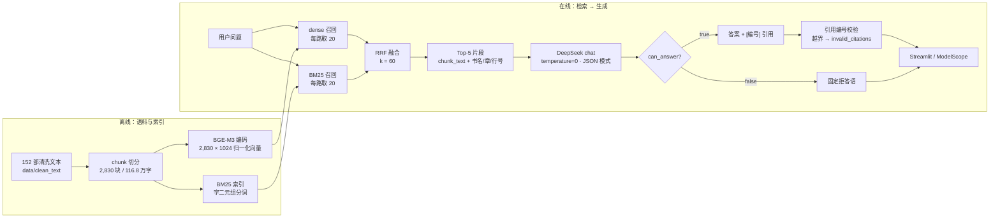
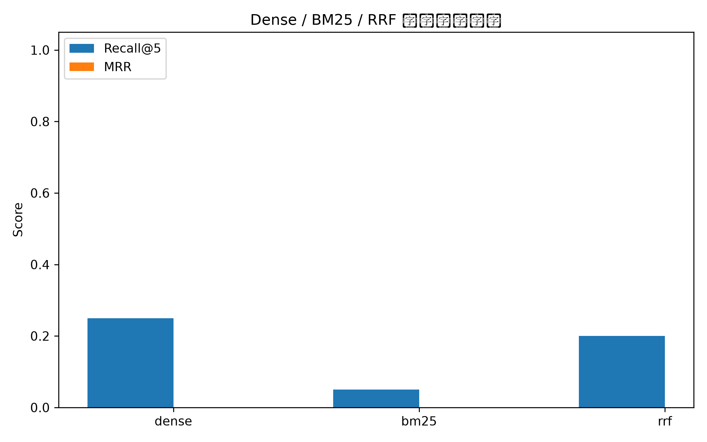

# 命理古籍 RAG · v1

一个「只回答古籍原文里写了什么」的检索增强问答系统：**16 部命理古籍 / 2,830 个 chunk / 116.8 万字** → BGE-M3 + BM25 双路召回 → RRF 融合 → DeepSeek 生成 → **强制引用 + 无依据拒答**。

[公开 Demo（ModelScope 创空间）](https://modelscope.cn/studios/Trueful/mingli-rag) ·
[直达 Streamlit](https://trueful-mingli-rag.ms.show) ·
[检索评测明细](eval/results_v2.csv) ·
[拒答评测明细](eval/refusal_results.csv) ·
[语料工程说明](docs/corpus_pipeline.md) ·
[开发日志](docs/daily_dev_journal.md)

> **免责声明**
> 本项目是大模型 RAG 的学习与作品集项目。语料是历史文献，系统不提供任何命理预测，也不构成人生决策建议，请勿把模型输出用于现实判断。
>
> **项目边界**
> 提示词明确禁止把古代概念套到现代生活（科举 ≠ 考研、田宅 ≠ 商品房、官星 ≠ 考公），检索不到依据就拒答。这条边界本身就是评测项之一（10 条语料外问题）。

---

## 1. 为什么做这个

古籍问答最要命的失败不是答得浅，而是**编造原文**——模型用现代常识补出一句听起来很像古籍的话，用户无法分辨。

所以 v1 的核心不是"答得好"，是**"每句结论都能指回原文某一段，指不到就说不知道"**。落到代码里就三件事：

1. 只允许使用检索到的 Top-5 片段，禁止使用预训练知识；
2. 每条结论必须标 `[编号]`，编号越界或为 0 条时直接标记为不合规输出；
3. 片段只是主题相近但答不了问题，就拒答（`can_answer=false`）。

可信度需要用数字证明，所以同时做了 30 条人工评测集和一套可重跑的评测脚本。

---

## 2. 架构



| 层 | 实现 | 位置 |
|---|---|---|
| 语料 | v1 只用 16 部标点组，2,830 chunk，目标 450 字 / 上限 700 / 句级重叠 60 | `data/chunks/punct.jsonl` |
| 向量化 | BGE-M3，1024 维，归一化后存 `.npy` | `src/embed.py` → `data/embeddings.npy` |
| dense 检索 | 纯 numpy 矩阵乘；2,830 条暴力全量，毫秒级，不需要向量库 | `src/retrieval.py:41` |
| 稀疏检索 | `rank_bm25` + 字二元组分词（不依赖 jieba 词典） | `src/retrieval.py:47` |
| 融合 | RRF，k=60，每路先取 20 再截 Top-5 | `src/retrieval.py:53` |
| 生成 | `deepseek-chat`，`temperature=0`，`response_format=json_object` | `src/rag.py:59` |
| 约束 | 引用编号 → chunk_id 映射与校验；声称能答但零有效引用 → `invalid_output` | `src/rag.py:116` |
| 界面 | Streamlit：三档检索切换、Top-k 调节、召回块/引用块左右对照 | `src/app.py` |
| 部署 | ModelScope 创空间，入口见 `modelscope.yml` | `app.py` |

**一次请求发生了什么**

1. 用户问题进 `retrieve_one(question, top_k, mode)`；
2. dense 与 BM25 各取 20 条候选，RRF 融合后截 Top-5（`mode` 可强制只走单路，界面里就是那三个单选框）；
3. 5 个片段按 `[1]…[5]` 编号拼进 prompt，每个片段带《书名·卷·章》；
4. DeepSeek 返回 JSON：`can_answer / answer / citations / refusal_reason`；
5. `citations` 里的编号校验在 1..5 之间，映射回 `chunk_id`；越界编号进 `invalid_citations`，界面红色报错。

---

## 3. 结果

评测集 30 条：**20 条可答**（单跳释义 8 / 口语改写 4 / 应用推理 4 / 跨书对比 3 / 多跳综合 1）+ **10 条语料外**（考研、考公、买房、整容、彩票等）。全部 Top-k=5。

### 3.1 检索

| 策略 | Recall@5（exact） | Recall@5（line） | MRR（exact） | MRR（line） |
|---|---:|---:|---:|---:|
| dense（BGE-M3） | 52.5% | 62.5% | 41.2% | 48.7% |
| BM25（字二元组） | 42.5% | 52.5% | 36.0% | 38.7% |
| **RRF 融合** | **65.0%** | **70.0%** | 50.8% | 61.7% |

语料从 2,830 条扩到 8,681 条后，RRF 的 line Recall@5 由 77.5% 降到 70.0%：
两路各自都没退步（dense 不变、BM25 从 47.5% 涨到 52.5%），退化发生在融合环节，
说明 `rrf_k=60` / `candidate_k=20` 是在小候选池上调出来的，池子大了一倍需要重调。
两次评测的完整明细见 `eval/baselines.md`。



- **exact**：返回的 `chunk_id` 必须等于标注的 gold 块；
- **line**：同一本书且行区间相交就算命中，用来吸收 chunk 边界差异（口径更松，两个数一起报）。

分题型 Recall@5（RRF，line 口径）：

| 题型 | n | Recall@5 |
|---|---:|---:|
| 单跳释义 | 8 | 75% |
| 口语改写 | 4 | 50% |
| 应用推理 | 4 | 100% |
| 跨书对比 | 3 | 100% |
| 多跳综合 | 1 | 50% |

### 3.2 生成与拒答

| 指标 | 结果 | 说明 |
|---|---|---|
| 语料外拒答率 | **10/10** | 全部拒答，没有一条被"算"成命理问题 |
| 可答题误拒 | 1/20 | q01（见 4.1） |
| 回答中至少一条引用命中 gold | 15/19 | 78.9%；剩下 4 条答了但没有引到标注块 |
| 首条引用即命中 gold | 11/19 | 57.9%——引用能对上，但排序不对 |
| 不合规输出（`invalid_output`：声称能答却零有效引用） | 0/30 | 引用编号全部落在 1..5 内 |

---

## 4. 失败案例

这一节按"实际发生了什么"写，不按指标好不好看做筛选。

### 4.1 RRF 把单路强命中挤出了 Top-5（q01）

「算命的说我命里带羊刃…白天生和晚上生犯的不一样吗？」

dense 把 gold（`chunk 83`，张果星宗）排在**第 2 名**；BM25 没有召回它；融合后 gold 掉出 Top-5，系统于是**误拒**。

原因是 RRF 只吃排名、不看分数：每路只取 20 条候选，gold 不在 BM25 前 20，融合分只有 `1/(2+60) ≈ 0.016`；而一个两路都排第 20 的弱相关块能拿到 `2/80 = 0.025`。**"两路都出现"压过了"单路很强"**。

这是"混合检索一定比单路好"的直接反例，也是 v1.1 第一个要改的地方（加深候选池 / 加权融合 / 对单路 top-3 做保底）。

### 4.2 拿到了等价的另一块，但 gold 只标了一块（q03）

「禄、命、身三样分别怎么定？」

gold 是 `五行精纪` 第 621 块（"谈命者当分禄命身，以干配禄，以支合命，以纳音论身"）。模型召回并引用了第 676 块（"干为禄，定贵贱；支为命，定修短；纳音为身，察盛衰"）——**内容同样成立，引用也正确**，但按 chunk_id 严格比对记 0 分。

同类情况：q13「丁未碰癸丑、丁丑、己丑算不算破」——原文其实就在第 **927** 块，gold 标注却是相邻的第 926 块（两块的行区间共享第 3383 行）。模型引用 927 是对的，exact 判 0、line 判 1。**这里错的是标注，不是模型。**

结论：**exact 口径会低估**，单 gold 标注也会低估。这两个 0 不是检索失败，是人写的评测口径太窄。对外宣传用 line 口径时，必须同时说明这一点。

### 4.3 真正的检索失败：口语改写（q09、q11）

「甲木是栋梁、乙木是花草，乙木命不如甲木？」「乙木的长生位跟甲木相反？」

三档检索、两种口径**全部为 0**。古籍原文没有"栋梁/花草"这种说法，BM25 字面零交集；BGE-M3 也没把口语转述映射到《滴天髓阐微》的"五阳皆阳丙为最"。

口语改写类 line Recall 只有 50%，是所有题型里最弱的。这不是模型大小的问题，是**查询侧没有做改写/术语映射**。

### 4.4 BM25 赢、向量输的例子（q10、q15、q16）

- q10「两个地支相冲，怎么知道谁强谁弱」：BM25 exact=1.0，dense exact=0；
- q15「乙木日主，伤官旺、庚金成病，走壬申癸酉还是丙子丁丑」：BM25 exact=1.0，dense exact=0；
- q16「丙午年庚寅月初九午时，几岁起运」：BM25 exact=1.0，dense exact=0。

干支组合、术语原词这类**字面强信号**问题，BM25 明显更好。混合检索的理由不是"两个都比一个强"，而是**两类错误不重叠**。

### 4.5 多 gold 只中一半（q20）

「甲木生在正月，没火、水偏多，是不是不好？」

gold 两段（`2750` 总论、`2751` 正月甲木），只召回 2751，Recall@5 = 0.5。多跳题需要两段拼起来才能答，v1 的 Top-5 是"取排名前 5"，没有任何多样性约束，容易全落在同一段。

---

## 5. 局限（诚实清单）

| # | 局限 | 影响 | 下一步 |
|---|---|---|---|
| 1 | 索引已覆盖 45 部 / 8,681 块（标点组 16 部 + 无标点组 29 部），但**评测集仍只按前 16 部出题** | 70.0% 只代表"问的书在库里"时的检索质量，29 部无标点组还没有对应题目，真实覆盖率未被测量 | 为无标点组补 30–40 道题，再重跑一次 |
| 2 | 评测集 30 条、单人标注，可答 20 条 | 1 条题 = 5 个百分点；跨书对比只有 3 条、多跳 1 条，题型间差异不可靠 | 扩到 80 条 + 双人标注 |
| 3 | exact / line 两个口径差 5–10 个点；line 口径偏松（共享一行即命中） | 只报一个数会误导；q03/q13 说明 exact 也会误伤 | 两个数一起报；补"引用段落包含答案要点"的人工核验 |
| 4 | chunk 目标 450 字、句级重叠 60 字 | 定义跨块时仍会切断答案；相邻块内容重复，`exact` 判分不稳 | v2 调重叠与边界规则 |
| 5 | BM25 用字二元组，**没有接 jieba 和 324 条术语词典**（词典已备好未接入） | 古汉语单字词多，二元组引入噪声；口语 query 字面零交集 | 接入 jieba + 术语词典 |
| 6 | RRF 参数未调（k=60、每路 20 条），且没有 reranker | q01 说明融合会伤害单路强命中 | 加深候选池、上 bge-reranker |
| 7 | 生成侧只校验**引用编号是否合法**，不校验"这段原文是否支持这句话" | 4/19 题回答没有任何 gold 引用；没有忠实度指标 | 加 RAGAS faithfulness / 人工抽检 |
| 8 | 没有查询改写，没有多轮对话 | 口语改写类最弱（50%） | query rewrite / HyDE 对比实验 |
| 9 | 延迟与成本没有测量 | 无法回答"端到端多少秒、一次多少钱" | 加计时与 token 统计，README 补数字 |
| 10 | 工程细节：数据路径曾硬编码 `/workspace`（已改为仓库相对路径 + `MINGLI_DATA_DIR`）；Demo 无鉴权、无限流 | 本地复现原本会直接报错 | 用环境变量 + 部署文档 |
| 11 | 内容边界：古籍里的概念与现代生活不是一一对应 | 可能出现不恰当类比 | 提示词硬约束 + 拒绝样例回归测试 |

> 关于"没做完"的部分：reranker、查询改写、多轮、微调、换 LangChain/LlamaIndex 重写，v1 明确**不做**。判断标准是"能不能让 11 月 1 日的简历多一个数字或一个链接"，不能就推迟到 v2。

---

## 6. 快速开始

```bash
git clone https://github.com/true-12138/mingli-rag.git
cd mingli-rag

python -m venv .venv
source .venv/bin/activate          # Windows: .venv\Scripts\activate
pip install -r requirements.txt

export DEEPSEEK_API_KEY=sk-xxxx    # PowerShell: $env:DEEPSEEK_API_KEY="sk-xxxx"
streamlit run app.py
```

- `data/embeddings.npy`（2,830 × 1024，约 12 MB）**已随仓库提供**，开箱即用。它目前只覆盖 v1 的标点组：语料已扩到 8,681 条，索引尚未重建，启动时会打印 `[warn] 索引只覆盖前 2830 条语料`，只检索已编码的部分。
- 要让无标点组也进入检索：先 `python src/build_index.py` 校验语料，再 `python src/embed.py` 重新编码（8,681 条，GPU 上十几分钟，纯 CPU 要数小时）
- BGE-M3 权重首次加载需要下载（几 GB）。大陆网络可先设 `HF_ENDPOINT=https://hf-mirror.com`，或用 ModelScope 下载后指向本地目录
- 重跑检索评测（**不调用 LLM**，只测检索）：`cd eval && python eval_matrics.py`
- 重画结果图：`python eval/make_chart.py`
- 语料路径默认 `<repo>/data`，可用环境变量覆盖：`MINGLI_DATA_DIR=/path/to/data`

**密钥**：只从环境变量 / `.env` 读取，`.env` 已在 `.gitignore` 里，仓库不含任何 key。

---

## 7. 目录结构

```text
.
├── app.py                     # Streamlit 入口（ModelScope 按 modelscope.yml 拉起）
├── src/
│   ├── app.py                 # 界面：检索策略、Top-k、召回与引用对照
│   ├── corpus.py              # 语料唯一入口：文件顺序、chunk_id 编号、字段契约
│   ├── retrieval.py           # dense + BM25 + RRF（纯 numpy）
│   ├── rag.py                 # DeepSeek 调用、JSON 强制、引用校验、拒答
│   ├── build_index.py         # 建索引前校验（编号连续、gold 有效、无重复）
│   ├── embed.py               # BGE-M3 离线编码 → data/embeddings.npy
│   ├── chunk_*.py             # 语料切分（细节见 docs/corpus_pipeline.md）
│   └── validate_chunks.py     # chunk 数据契约校验
├── eval/
│   ├── questions.jsonl        # 30 题评测集（20 可答 + 10 语料外）
│   ├── eval_matrics.py        # 三档检索 × exact/line 两种口径
│   ├── eval_refusal.py        # 拒答评测
│   ├── results_v2.csv         # 检索明细（每题每题型的命中）
│   ├── refusal_results.csv    # 拒答明细（含模型原始回答）
│   └── make_chart.py          # 由 results_v2.csv 生成对比图
├── data/
│   ├── chunks/punct.jsonl     # 标点组（2,830 行，chunk_id 1..2830）
│   ├── chunks/unpunct.jsonl   # 无标点组（5,851 行，chunk_id 2831..8681，待编码）
│   ├── chunks/index_report.json # build_index.py 产出的校验报告
│   └── embeddings.npy         # 2,830 × 1024
├── docs/
│   ├── corpus_pipeline.md     # 语料工程说明（原 README）
│   ├── daily_dev_journal.md   # 开发日志与踩坑
│   └── eval_questions_seed.md
├── ATTRIBUTION.md             # 语料来源与许可证
└── PLAN.md                    # 冲刺计划与范围冻结
```

---

## 8. 评测口径

写在代码里，可重跑（`eval/eval_matrics.py`）：

- **Recall@5**：gold 块中被 Top-5 覆盖的比例；多 gold 题按比例给分（q17/q18/q19/q20）；
- **exact**：`chunk_id` 严格相等；
- **line**：同一 `sourcefile` 且 `[line_start, line_end]` 区间相交（吸收边界差异，偏松）；
- **MRR**：第一个 gold 命中的排名取倒数，无命中为 0；
- **拒答**：`can_answer=false` 才算拒答；可答题被判 false = 误拒；语料外题被判 true = 漏拒。

---

## 9. 路线图

- **v1.1（11 月）**：reranker（bge-reranker-v2-m3）、RRF 候选池加深、jieba + 术语词典、补一组前后对比数字
- **v2（12 月）**：29 部无标点古籍入库（行款合并 + 断句）、评测扩到 80 条 + RAGAS 忠实度、FastAPI + Docker、延迟与成本测量
- **明确不做**：微调、多轮对话、框架重写、向量库（2,830 条暴力检索足够，面试时能解释"为什么不用 HNSW"比接了更像工程判断）

---

## 10. 数据来源与许可

语料来源、版本、许可证与使用边界见 [`ATTRIBUTION.md`](ATTRIBUTION.md)。古籍原文来自公开整理本，仅用于技术研究与学习；若再分发派生文本，请一并保留该文件。

再次强调：**本项目不做任何命理预测**，模型输出不得用于现实决策。
